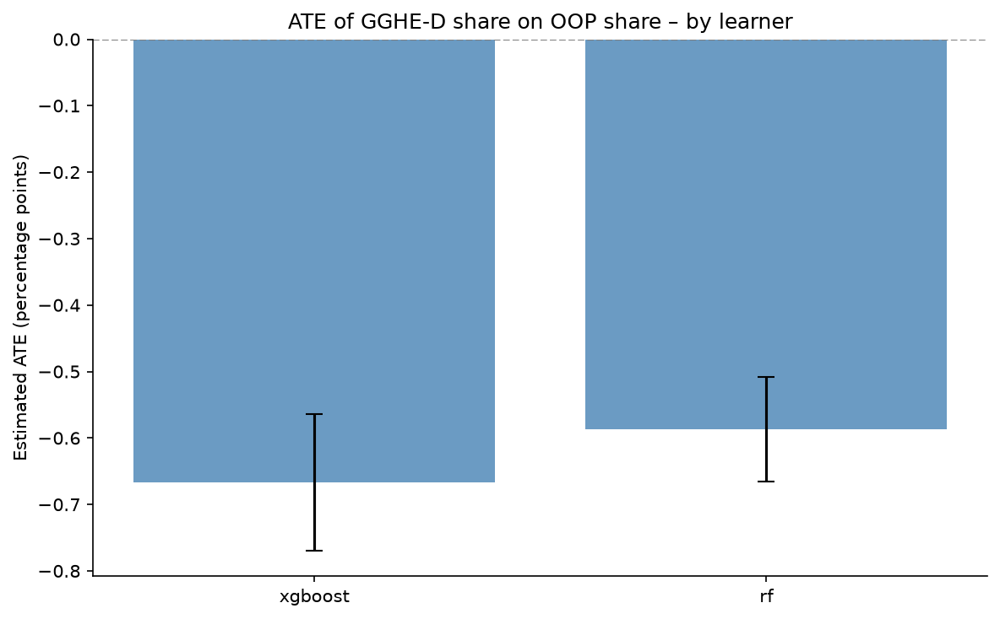
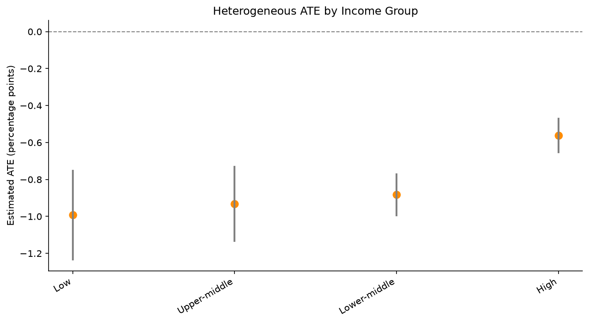

# Causal Effects of Public Health Financing on Out-of-Pocket Expenditure

Double Machine Learning and Causal Forest analysis of WHO Global Health Expenditure Database (GHED) data, framed as a Target Trial Emulation.

---

## What this project does

The central question is simple but policy-relevant:

**Does a higher share of government financing in total health expenditure reduce the share that households pay out of pocket?**

I examine this using country-year data from the WHO Global Health Expenditure Database (2000–2023). The analysis is set up as a Target Trial Emulation and estimated with Double Machine Learning (partially linear model) and, for heterogeneity, both stratified estimates and a Causal Forest.

---

## Target Trial Emulation

Rather than treating the observational data as a black box, the analysis is organised around an explicit target trial:

| Component | Choice made here |
|-----------|------------------|
| Eligibility | Country-years with non-missing values on the main financing and expenditure variables (2000–2023) |
| Treatment | Domestic General Government Health Expenditure as % of Current Health Expenditure (`gghed_che`) |
| Outcome | Out-of-pocket expenditure as % of Current Health Expenditure (`oops_che`) |
| Causal contrast | Average treatment effect of a higher government financing share |
| Effect modification | Explored by World Bank income group and via Causal Forest |

This keeps the identifying assumptions visible and makes the link to the epidemiological literature on target trials clear.

---

## Main results

**DoubleML (XGBoost nuisance models, 5-fold cross-fitting)**

| Quantity | Estimate |
|----------|----------|
| ATE | −0.689 |
| Std. error | 0.050 |
| 95% CI | [−0.787, −0.590] |
| p-value | < 0.001 |

A one-percentage-point increase in the government share of health spending is associated with a reduction of roughly 0.69 percentage points in the out-of-pocket share. The estimate is stable when the nuisance functions are estimated with random forests instead of XGBoost (ATE ≈ −0.56).

**Heterogeneity by income group**

| Income group | ATE | 95% CI | N |
|--------------|-----|--------|---|
| Low | −0.866 | [−1.062, −0.669] | 565 |
| Lower-middle | −0.848 | [−0.979, −0.717] | 1,207 |
| Upper-middle | −0.748 | [−0.931, −0.565] | 1,159 |
| High | −0.525 | [−0.615, −0.435] | 1,093 |

The protective association is visibly stronger in lower-income settings. This pattern is consistent with the idea that public financing matters more where private payments are a larger residual burden.





---

## Estimation approach

The core model is the partially linear specification used in DoubleML:

$$
Y = \theta D + g(X) + \varepsilon, \qquad D = m(X) + \nu
$$

- \(D\): `gghed_che`
- \(Y\): `oops_che`
- \(X\): external financing share, CHE as % of GDP, log CHE per capita, and GGHE-D as % of GDP

Nuisance functions \(g\) and \(m\) are estimated with gradient boosting or random forests, and cross-fitting is used to avoid overfitting bias. The resulting estimator for \(\theta\) is double-robust.

For effect heterogeneity I report both simple stratified ATEs (by income group) and summaries from a Causal Forest (`econml.grf`). The stratified results are the most transparent; the forest provides a check that the pattern is not an artefact of the particular grouping.

---

## Data

- WHO Global Health Expenditure Database, December 2025 release
- 183 countries, years 2000–2023
- Final analysis sample: 4,024 country-year observations after dropping incomplete records

The raw Excel file is kept outside the repository (see `data/README.md`).

---

## How to run

```bash
python -m venv .venv
source .venv/bin/activate          # Windows: .venv\Scripts\activate
pip install -r requirements.txt

# place GHED_data.XLSX in data/
python scripts/run_doubleml.py
```

---

## Why this is relevant for methodological work in epidemiology

The project is deliberately modest in scope but careful on method:

- The analysis is written as a Target Trial Emulation rather than a purely algorithmic exercise.
- Double Machine Learning is used in its standard partially linear form, with explicit cross-fitting and robustness checks across learners.
- Heterogeneity is examined both by pre-specified strata and with a forest-based approach.
- Code is modular and can be extended (additional confounders, alternative scores, or a proper software package structure).

These are the kinds of choices that matter when causal methods are applied to secondary health-system data.

---

## References

- Chernozhukov et al. (2018). Double/debiased machine learning for treatment and structural parameters. *The Econometrics Journal*.
- Hernán & Robins. *Causal Inference: What If*.
- WHO Global Health Expenditure Database: https://apps.who.int/nha/database

---

## License

MIT
